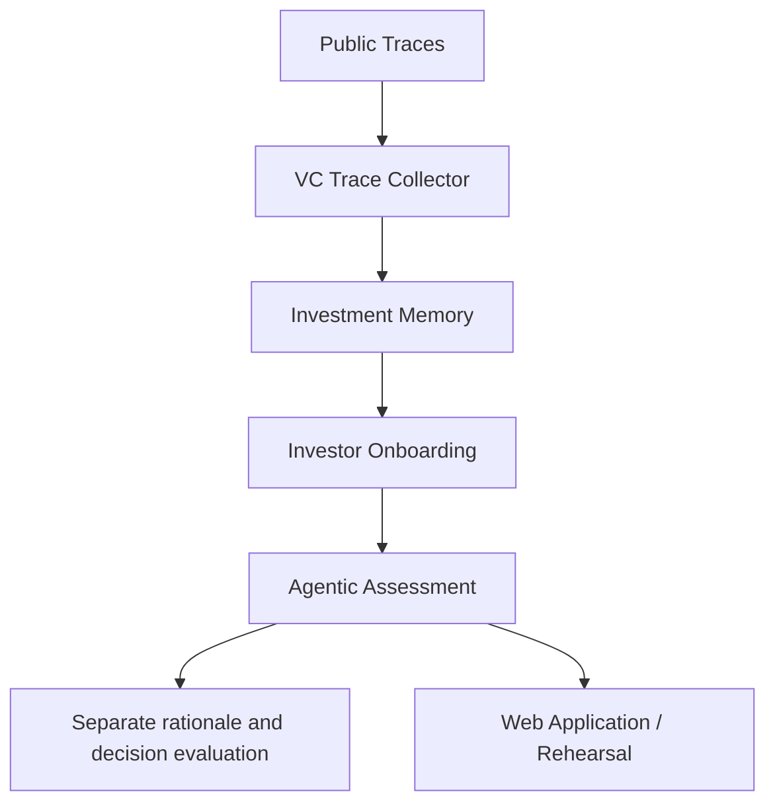

# VCLogic suite

VCLogic studies an evidence-grounded approximation of an investor’s observable evaluative logic. Reconstructing investment rationales and predicting investment decisions are separate research tasks. This repository coordinates five existing components at exact Git revisions behind one CLI, `vclogic`; their scientific logic stays in their own repositories.

## Install everything

Requires Python **3.12.12**, **uv 0.9.17**, Git, and Node.js/npm. The collector also needs two host tools; `init` lists any that are missing:

| Tool | Install |
|---|---|
| ffmpeg | Windows `winget install Gyan.FFmpeg` · macOS `brew install ffmpeg` · Linux `sudo apt install ffmpeg`. Open a new terminal afterwards. |
| mcporter with Exa search | `npm install -g mcporter`, then `mcporter config add exa https://mcp.exa.ai/mcp --scope home`. Test it with `mcporter call exa.web_search_exa query=test numResults=1`. |

```bash
uv sync
uv run vclogic init
uv run vclogic doctor
cp .env.example .env    # Windows PowerShell: Copy-Item .env.example .env
```

What these do:

- `uv sync` installs the suite CLI.
- `vclogic init` fetches all five repositories at their pinned revisions into `.components/` and installs every component environment. That covers the collector, Investment Memory, onboarding, assessment and the web app, plus all research extras: embeddings, personalized assessment, collector browser/YouTube/Whisper/pyannote, PDF extraction, Chromium and the built web frontend. It shows step-based progress. Rerunning it is safe: matching checkouts and environments are reused, and clean checkouts move to new pins after a suite update. A checkout with local changes is never overwritten.
- `init` ends with a JSON report. `"ready": true` with an empty `"missing_prerequisites"` means the host is complete. Otherwise the report names each missing tool and exits nonzero: ffmpeg, Node/npm, Codex or Claude Code, mcporter, or a Chromium that cannot launch. It never runs sudo or installs system software.
- `vclogic doctor` checks without network access that every component is `pinned and clean`.
- `.env` holds secrets only and is never committed. Non-secret settings live in `vclogic.toml`. What to put in it is described next.

`init` performs no inference. Model weights download the first time a model is used. Logging in to Codex or Claude Code, provider keys and gated Hugging Face model access remain your responsibility.

### Fill in `.env`

Open `.env` in an editor and paste values after the `=`, with no quotes or spaces. The no-key demo (`vclogic test`) needs none of them. For a new investor, two keys are required:

| Variable | Used by | How to get it |
|---|---|---|
| `OPENROUTER_API_KEY` | `assess` and `web`, which make the LLM calls for rationales and decisions | [openrouter.ai/keys](https://openrouter.ai/keys) → Create key. Add credit; calls are billed by OpenRouter. |
| `HF_TOKEN` | Collector voice step (speaker detection and voice matching) | [huggingface.co/settings/tokens](https://huggingface.co/settings/tokens) → a *Read* token. While logged in, also accept the terms on [pyannote/speaker-diarization-3.1](https://huggingface.co/pyannote/speaker-diarization-3.1) and [pyannote/segmentation-3.0](https://huggingface.co/pyannote/segmentation-3.0). |

Optional; leave blank unless one applies:

| Variable | Set it when |
|---|---|
| `VC_TRACE_AV_DEVICE` | Leave `cpu` (the default). `cuda` helps only on Linux with an NVIDIA GPU; Windows installs a CPU-only PyTorch, so the collector falls back to CPU there. |
| `OPENAI_API_KEY` | You switched an assessment config to the OpenAI provider |
| `VC_TRACE_SEARCH_ENDPOINT` | You run your own SearXNG and want the collector to search through it |
| `VC_TRACE_LLM_ENDPOINT`, `VC_TRACE_LLM_API_KEY`, `VC_TRACE_DISCOVERY_MODEL` | You want model-assisted source discovery. All three are needed together. |
| `VC_TRACE_ALLOW_ENV_PROXY=1`, `NODE_USE_ENV_PROXY=1` | Your network requires `HTTP(S)_PROXY`. Without them the collector times out. |

Two things are **not** in `.env`, because they log in once on the machine:

- **Memory generation** uses your Codex or Claude Code account. Run `codex login` or `claude` once.
- **Agent Reach / Exa search** is configured through `mcporter`.

`init` reports whether Codex/Claude and mcporter are installed. Variables exported in your shell override `.env`, and component folders' own `.env` files are ignored.

### Other install options

| Command | Installs | Use it for |
|---|---|---|
| `vclogic init` | Everything (same as `--profile all`) | The full research workflow; the default |
| `vclogic init --profile web` | Onboarding, assessment and the web app, without the collector | Serving and assessing already prepared investors |
| `vclogic init --profile core` | Onboarding and assessment environments only; no extras, no web, no collector | The no-key reviewer smoke test below; smallest download |
| `--embeddings` | Adds embedding libraries to `core` or `web` | Building or querying semantic indexes without the full install |
| `--offline` | Uses only local checkouts and cached packages | Repeating setup without network access |

All profiles fetch all five repositories. `vclogic bootstrap --profile ...` is the older setup command. It installs a profile without the full-setup host checks.

## Run a new investor

Put secrets in `.env` and settings in `vclogic.toml`, then:

```bash
uv run vclogic run --name "Investor Name"     # collect (interactive) → memory → onboard → install
uv run vclogic assess --investor investor-slug --pitch /abs/pitch.txt --company "Acme"
uv run vclogic web                             # every installed investor in the UI
```

**What costs money:**

| Step | Spends money on |
|---|---|
| memory (inside `run`) | Your Codex or Claude Code plan or usage while it writes the investment memory |
| `assess` and `web` | OpenRouter calls billed to `OPENROUTER_API_KEY` |
| `onboard -- --from-pitch-show` | LLM extraction of Pitch Show decisions |

Collection is free with the default and Agent Reach/Exa search. The wizard asks for spending limits only if you say your search backend charges per search.

Only collection is interactive: the collector's guided wizard asks for identity and source review. Memory generation uses Codex or Claude Code, selected with `[memory] harness`. Rerunning `run` skips finished stages. Newly onboarded investors appear in a running web app without a restart. `assess` prints the investor's rationales and decision and saves them under `workspace/research/assessments/`. Agents can use the `/vclogic` skill in `.agents/skills/vclogic/`. See [the full research workflow](docs/full-pipeline.md) for every step.

## No-key reviewer demonstration

```bash
uv sync
uv run vclogic init --profile core
uv run vclogic test
```

Alternatively, run the CPU-only container:

```bash
docker compose up --build
```

The container holds only the `core` profile and runs the demo with networking disabled after its build. A warm demo took approximately 30 seconds on the audited Linux host; initial source/dependency downloads take longer. Successful execution prints `Validation passed` and leaves separate rationale and In/Out artifacts with evidence links. See [Docker](docs/docker.md) for image size and limitations.

`vclogic test` only runs the no-key smoke workflow, component validators, and provenance checks. It never fetches repositories or installs dependencies; missing or stale setup produces an instruction to run `init`. Setup needs network access, but the test needs no API keys, model weights or GPU. After setup, use `uv run vclogic test --offline`. Runtime and download size depend on caches and platform; no cold-start duration is promised.

The demo validates a frozen Elizabeth Yin memory with the real validator, recomputes wiki-only onboarding, and runs the existing scripted Elizabeth/Thoras assessment example **in a separate workspace against its original input snapshot**. Those frozen inputs come from the component commits recorded in `manifests/reviewer-artifacts.json` and are fetched into `.components/fixtures/`. The new onboarding bundle is valid but **not assessment-ready** because indexes are deliberately skipped. The assessment uses a fake provider and contract v1. These stages are not a continuous same-snapshot pipeline and do not reproduce a publication’s findings.

Inspect `workspace/latest.json` for the latest run location. Each `workspace/runs/<id>/` contains `report.json`, a Markdown summary, provenance and stage logs. Verification checks recorded inputs and native artifacts; a successful smoke test establishes neither scientific accuracy nor human fidelity. Publication metric reproduction is unavailable until a coherent archive, human labels, analysis configuration and citation are supplied.

## Components

| Component | Responsibility |
|---|---|
| Trace Collector | Collect and review public evidence; not run by the default demo |
| Investment Memory | Build cited memories; demo validates a frozen memory |
| Investor Onboarding | Package, check and install memory bundles |
| Agentic Assessment | Retrieval, rationale investigation, decision synthesis and rehearsal |
| Web Application | UI consuming prepared assessment assets |



Source URLs, full commits and local aliases are in [the component manifest](manifests/components.lock.json). Downloaded checkouts live under `.components/`; generated data lives under `workspace/`. Component locks are used as published; memory runs inside the locked onboarding environment.

```bash
uv run vclogic components             # inspect exact pins
uv run vclogic doctor                 # offline checkout status
```

Global path options precede the subcommand, for example `uv run vclogic --workspace /tmp/reviewer-output demo`. See [the reviewer guide](docs/reviewer-guide.md), [architecture](docs/architecture.md), [reproducibility](docs/reproducibility.md), [full research workflow](docs/full-pipeline.md), [Docker](docs/docker.md), and [troubleshooting](docs/troubleshooting.md).

The [Phase 1 audit](docs/component-audit.md) is a historical record, including known compatibility issues and component test failures; its statements that the suite was not yet implemented describe that audit date. See [NOTICE](NOTICE.md) for unresolved rights and attribution. No publication citation or project-wide license grant has been provided.

See [implementation verification](docs/implementation-verification.md) for executed checks and remaining research-release boundaries.
