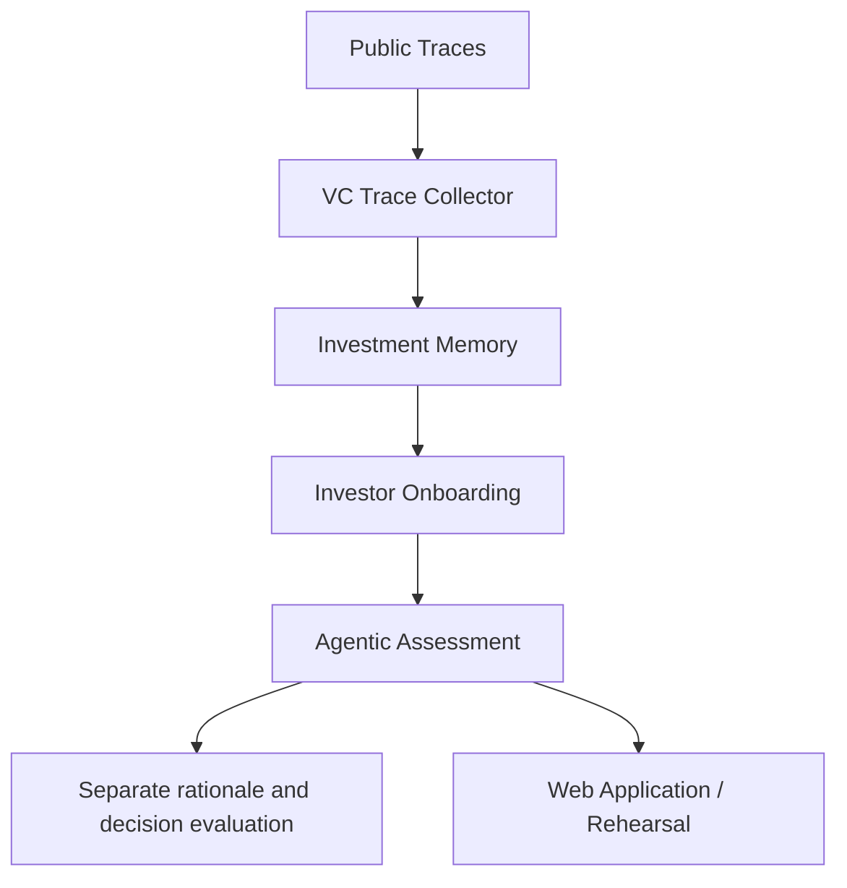

# VCLogic suite

VCLogic studies an evidence-grounded approximation of an investor’s observable evaluative logic. Reconstructing investment rationales and predicting investment decisions are separate research tasks. This repository coordinates five component repositories at exact Git revisions behind one CLI, `vclogic`; their scientific logic stays in their own repositories.

## Contents

1. [Requirements](#1-requirements)
2. [Installation](#2-installation)
3. [Environment variables](#3-environment-variables)
4. [Choose your path](#4-choose-your-path)
5. [Collecting public content](#5-collecting-public-content)
   1. [The seven wizard steps](#the-seven-wizard-steps)
   2. [If collection does not verify](#if-collection-does-not-verify)
6. [Memory generation and onboarding](#6-memory-generation-and-onboarding)
7. [Assessment](#7-assessment)
8. [Web interface](#8-web-interface)
9. [Evaluation](#9-evaluation)
   1. [Rebuild predictions.csv from runs](#rebuild-predictionscsv-from-runs)
   2. [Reproduce the proposal evaluation](#reproduce-the-proposal-evaluation)
10. [What costs money](#10-what-costs-money)
11. [Troubleshooting](#11-troubleshooting)
12. [No-key reviewer demonstration](#12-no-key-reviewer-demonstration)
13. [Components and further reading](#13-components-and-further-reading)

Run every command from the suite root, the folder that contains `manifests/components.lock.json`.

## 1. Requirements

1. Python **3.12.12**, **uv 0.9.17**, Git and Node.js with npm.
2. The tools below. Open a new terminal after installing them.

| Tool | Needed for | Install |
|---|---|---|
| ffmpeg | Collecting audio and video | Windows `winget install Gyan.FFmpeg` · macOS `brew install ffmpeg` · Linux `sudo apt install ffmpeg` |
| mcporter with Exa search | Collecting (source search) | `npm install -g mcporter`, then `mcporter config add exa https://mcp.exa.ai/mcp --scope home`. Test: `mcporter call exa.web_search_exa query=test numResults=1` |
| Codex CLI or Claude Code | Memory generation | At least one: [Codex CLI](https://developers.openai.com/codex/cli/) or [Claude Code](https://code.claude.com/docs/en/setup). Log in once with `codex login` or `claude`. |

## 2. Installation

```bash
uv sync                  # 1. install the suite CLI
uv run vclogic init      # 2. fetch the five pinned repositories and install everything
uv run vclogic doctor    # 3. check: every component must say "pinned and clean"
```

1. `init` installs the collector, Investment Memory, onboarding, assessment and the web app, with all research extras (embeddings, YouTube/Whisper/pyannote, PDF extraction, Chromium, the built web frontend). It runs no models; model weights download the first time they are used.
2. `init` ends with a JSON report. `"ready": true` with an empty `"missing_prerequisites"` means you are done. Otherwise it names each missing tool and exits nonzero. It never runs sudo or installs system software.
3. Rerunning `init` is safe: matching checkouts are reused, and clean checkouts move to new pins after a suite update. It refuses to touch a checkout with local changes (`Component … is modified`).

Smaller installs:

| Command | Installs | Use it for |
|---|---|---|
| `vclogic init` | Everything (same as `--profile all`) | The full workflow; the default |
| `vclogic init --profile web` | Onboarding, assessment and the web app, no collector | Serving and assessing already prepared investors |
| `vclogic init --profile core` | Onboarding and assessment only; no extras, web or collector | The [no-key demonstration](#12-no-key-reviewer-demonstration) |
| `--embeddings` | Adds embedding libraries to `core` or `web` | Semantic indexes without the full install |
| `--offline` | Only local checkouts and cached packages | Repeating setup without network access |

## 3. Environment variables

1. Copy the template: `cp .env.example .env` (Windows PowerShell: `Copy-Item .env.example .env`).
2. Open `.env` and paste each value after the `=`, with no quotes or spaces.

| Variable | Needed for | How to get it |
|---|---|---|
| `OPENROUTER_API_KEY` | [Assessment](#7-assessment) and the [web interface](#8-web-interface) | [openrouter.ai/keys](https://openrouter.ai/keys) → Create key. Add credit; OpenRouter bills the calls. |
| `HF_TOKEN` | [Collecting](#5-collecting-public-content) audio and video (pyannote) | [huggingface.co/settings/tokens](https://huggingface.co/settings/tokens) → a *Read* token. While logged in, accept the terms on [pyannote/speaker-diarization-3.1](https://huggingface.co/pyannote/speaker-diarization-3.1) and [pyannote/segmentation-3.0](https://huggingface.co/pyannote/segmentation-3.0). |

Optional; leave blank unless one applies:

| Variable | Set it when |
|---|---|
| `VC_TRACE_AV_DEVICE` | Set `cuda` before running `uv run vclogic init` to install and verify CUDA Torch wherever Torch is installed (collection, onboarding, assessment, web). Setup preserves component Torch versions and fails if GPU execution fails. Shell settings override `.env`. `cpu` keeps the locked builds. Embeddings use automatic device selection; this variable directly controls collector AV execution. |
| `HF_HOME` | Optional absolute model-cache directory, e.g. `E:/Projects/VCLogic Suite/.cache/huggingface`. Separate from uv's package cache; set it before downloading models. |
| `OPENAI_API_KEY` | You switched an assessment config to the OpenAI provider |
| `VC_TRACE_SEARCH_ENDPOINT` | You run your own SearXNG for the collector |
| `VC_TRACE_LLM_ENDPOINT`, `VC_TRACE_LLM_API_KEY`, `VC_TRACE_DISCOVERY_MODEL` | You want model-assisted source discovery. All three are needed together. |
| `VC_TRACE_ALLOW_ENV_PROXY=1`, `NODE_USE_ENV_PROXY=1` | Your network requires `HTTP(S)_PROXY`. Without them the collector times out. |

`.env` holds secrets only and is never committed. Variables exported in your shell override `.env`. Non-secret settings live in `vclogic.toml`:

```toml
[memory]
harness = "claude"   # or "codex"; "auto" asks each time
model = ""           # empty asks; or a model name, e.g. "sonnet"

[web]
port = 8000
```

Memory generation uses your Codex or Claude Code login, not a key in `.env`.

## 4. Choose your path

| You want to | Do |
|---|---|
| Add a new investor of your own | [5. Collecting](#5-collecting-public-content) → [6. Memory generation](#6-memory-generation-and-onboarding) → [7. Assessment](#7-assessment) or [8. Web interface](#8-web-interface) |
| Rebuild predictions and reproduce the proposal evaluation | [9. Evaluation](#9-evaluation) |
| Check the installation without keys | [12. No-key demonstration](#12-no-key-reviewer-demonstration) |

Shortcut for a new investor: `uv run vclogic run --name "Investor Name"` runs collection and memory generation in a row, and `uv run vclogic run --investor <slug>` resumes from the first unfinished stage.

## 5. Collecting public content

```bash
uv run vclogic collect --name "Elizabeth Yin"
```

The guided wizard creates the workspace `workspace/research/traces/<slug>/`, where the slug comes from the name, e.g. `elizabeth-yin`. Press `q` in triage, or Ctrl+C at a question, to stop; progress is saved, and `uv run vclogic collect --investor <slug>` continues where you left off. Continue to [memory generation](#6-memory-generation-and-onboarding) only after the wizard prints `Verified`.

### The seven wizard steps

1. **Identity: choose the investor's profile.** The wizard proposes profile pages. Choose the one that belongs to the investor, or enter a URL yourself (e.g. their own site's About page). Confirm `Is this the intended person's profile?` and then `Is this the right <name>?`. If a page cannot be retrieved (403, timeout), choose another one.
2. **Platforms: choose where to search.** Tick the platforms to skip; tick nothing to search all. Answer `Edit limits?` with yes only to change the search backend, results per query or the search ceiling.
3. **Triage: decide on every source.** This is the step that decides whether collection verifies. Use these keys:

   | Key | Action |
   |---|---|
   | `↑` `↓` | Move between sources |
   | `Enter` | Show details |
   | `a` / `x` | Approve / reject the source |
   | `r` | Cycle the source's role (see below) |
   | `u` | Add URLs of the investor's own material |
   | `/` | Search titles and URLs |
   | `p` | Skip or unskip a whole platform |
   | `A` | Approve all sources with confidence ≥ 0.8 |
   | `s` / `q` | Save and continue / save and quit |

   For **every approved source**, press `r` until the role is right:
   - `authored_by_target`: text the investor wrote (their blog, posts, essays).
   - `spoken_by_target`: talks, interviews and podcasts where the investor speaks.

   Only these two roles reach the corpus. A source left as `unknown` ends up `review_required` and is left out. Reject (`x`) pages about someone else or pages that only mention the investor. Include **at least two source types**, e.g. a blog plus talks.
4. **Fetch: download the approved sources.** The wizard shows audio/video minutes used against the limit (120 minutes by default) and how many recordings are left. If the approved talks need more, answer yes to `Raise the audio/video limit?` and enter the total minutes. Recordings past the limit are not downloaded. The summary ends with the paths of the failure and event logs.
5. **Voice: give a voice reference.** Audio and video need at least one reference clip of the investor's voice, or they are skipped.
   1. Answer yes to `Add a voice reference now?`.
   2. Pick a recording: a suggested one, `Browse all downloaded recordings`, or `Local file`.
   3. Open the YouTube link the wizard shows and find a stretch where **only the investor** speaks.
   4. Type that range, e.g. `0:00-0:50`. The clip is cut and saved as the reference.
   5. At `Add another reference?`, answer yes to add one from another video, or no to continue.
6. **Process.** Runs on its own: extracts text, transcribes and attributes speech. This can take a long time for many talks, especially on CPU.
7. **Finish.** Exports and verifies the corpus. If some sources failed to download (blocked sites, missing pages), the wizard says how many and asks `Accept a partial collection?`. Yes leaves the failed sources out, records that decision in the audit log, and verifies again. If approved talks have no audio/video result (media limit reached or download failed), it shows a warning with the list and asks `Leave these N talks out?`. Yes rejects them, records the decision, and verifies again; they will not be in the corpus or the memory. The wizard then prints `Verified` or `NOT verified`.

### If collection does not verify

You see `NOT verified` at the end of the wizard, or this when memory generation starts:

```text
memory: collector / verify
{ "passed": false, "errors": ["Quality report did not pass", ...] }
```

Running `run` or `memory` again repeats the same error, because a finished collection is not collected again. Fix the collection instead:

1. **Find the cause.** Open `workspace/research/traces/<slug>/quality_report.json`. Checks set to `false` and the `warnings` list say what failed:

   | You see | Cause | Fix in |
   |---|---|---|
   | `Corpus contains no eligible documents`, or many documents `review_required` in `processed/documents.jsonl` | Sources approved with role `unknown` | Triage (step 3) |
   | `Corpus has fewer than two source types` | Only one kind of source approved | Triage: approve or add (`u`) another type |
   | `Media duration … exceeds remaining limit` in `audit/failures.jsonl` | The audio/video limit ran out | Fetch (step 4): raise the limit |
   | `skipped …: no voice reference` | No voice reference saved | Voice (step 5) |
   | `Run has N failures`; `403`, `404` or timeouts in `audit/failures.jsonl` | Sites blocked the download or the page is gone. A failure still counts after you reject the source. | Finish (step 7): answer yes to `Accept a partial collection?` |
   | `Audiovisual outcomes do not cover every approved spoken source` | Approved talks that were never downloaded or processed | Finish (step 7): answer yes to `Leave these N talks out?`, or Fetch: raise the limit to include them |

2. **Reopen the wizard:** `uv run vclogic collect --investor <slug>`.
3. Answer **yes** to `Collection is finished. Redo from a step?` and choose **`triage`**.
4. **Fix what step 1 found**, following [the wizard steps](#the-seven-wizard-steps) 3–7: set roles with `r`, reject with `x`, raise the limit in fetch, add a voice reference, and accept a partial collection at finish if sources failed.
5. **Let the wizard finish.** Fetch downloads only what is missing or failed, and process reprocesses everything with the new roles. Repeat until it prints `Verified`.
6. **Continue** with [memory generation](#6-memory-generation-and-onboarding).

To repeat only processing, export and verification without changing any decision, use `uv run vclogic process --investor <slug>`.

## 6. Memory generation and onboarding

```bash
uv run vclogic memory --investor <slug>
```

1. **Verify.** The suite verifies the collection again. If verification fails, it stops before any paid work; see [If collection does not verify](#if-collection-does-not-verify).
2. **Choose the harness and model.** If both Codex and Claude Code are installed, a menu asks which one; then a second menu asks for the model (the default, Claude Code's `sonnet` / `opus` / `haiku`, or a name you type). Set `harness` and `model` under `[memory]` in `vclogic.toml` to skip the questions.
3. **Write the memory.** This uses your Codex or Claude plan and can take a while. Finished batches are cached in `workspace/research/memory-cache/<slug>/`, so rerunning after a failure with the same model repeats only the failed ones.
4. **Validate the memory** and save it to `workspace/research/wiki/<slug>/`.
5. **Package** the memory into a bundle with semantic indexes in `workspace/research/bundles/<slug>/` (embedding weights download on first use).
6. **Check** that the bundle is valid and `ready_for_assessment`.
7. **Install** the bundle into `workspace/research/pipeline/`. The investor now appears in [assessment](#7-assessment) and in the [web interface](#8-web-interface), and the command prints `Investor <slug> is ready` with the next commands.

Running it again is safe. An existing memory is never regenerated: it is validated again and onboarding continues, and an investor that is already installed is skipped. To build another version, use a new workspace: `uv run vclogic --workspace /abs/new/path memory --investor <slug>`. To repeat only steps 5–7, use `uv run vclogic onboard --investor <slug>`.

## 7. Assessment

```bash
uv run vclogic assess --investor <slug> --pitch /abs/path/pitch.txt --company "Acme"
```

1. Phase 1 investigates the investor's rationales; Phase 2 synthesises the investment decision.
2. The assessment is printed and saved as `workspace/research/assessments/<slug>/<session>.md` and `.json`.

`--investor` is any installed investor: the slug from [memory generation](#6-memory-generation-and-onboarding). `--company` is required and can be repeated for aliases; that company's own material is excluded from retrieval to prevent leakage. Calls are billed to `OPENROUTER_API_KEY`.

## 8. Web interface

```bash
uv run vclogic web
```

1. Open `http://localhost:8000` (or the `[web] port` from `vclogic.toml`; `--port 8001` overrides it). Leave it running.
2. **Settings → Investors** lists every installed investor with its ready version: "Installed profile" for each installed investor. Newly onboarded investors appear without a restart.
3. Create a pitch: the company name and the founder's pitch.
4. Assess it with one investor, or select two to six investors to compare them. Tick **Authorize provider API costs**: each investor costs about USD 0.10–0.20 and takes 5–10 minutes, billed to `OPENROUTER_API_KEY`. The first assessment also downloads the embedding model (about 0.5 GB). An assessment interrupted by a restart shows "Not running"; authorize and update the comparison to run it again.
5. **Historical fit percentile** ranks the pitch against the twin's likelihoods for that investor's past pitches on the show, from `proposal-evaluation/data/predictions.csv`. It needs at least 10 scored past pitches for that investor, on their installed profile; otherwise it shows "Unavailable" and the number of past pitches found.
6. From a finished assessment you can start a rehearsal, in which the twin questions the founder. Rehearsals can be deleted from the rehearsal library or a pitch's **Rehearsals** tab.

## 9. Evaluation

Both commands make no model calls. Their inputs live in `workspace/research/pipeline/proposal-evaluation/data/`: `annotations.csv` (the investors' coded rationales, with each decision's outcome) and `predictions.csv` (the twin's rationales and calls), plus `taxonomy.json`, `funnel.jsonl`, `funnel_counts.json`, `memory_sizes.json`, `no_decision_responses.csv`, `reference_second_coding.jsonl`, `single_call.jsonl`, `single_call_run.json` and `sol_pilots.json` for the remaining tables.

### Rebuild predictions.csv from runs

`predictions.csv` has one row per rationale the twin gave, by stage (`investigator`, `taxonomy_review`, `decision_agent`), with the weighted rationale score and its call, and the decision agent's call and likelihood.

```bash
uv run vclogic predictions --runs /abs/path/to/runs --out workspace/rebuilt-predictions.csv
```

1. `--runs` is searched for two layouts: case folders (`<investor>/<episode>/` with `investigation.json`, `coverage.json`, `final_lens.json` and `decision.json`), and live run folders from the assessment pipeline (`run-config.json`, `phase1/investigation.json` and `phase2/decision.json`, with `coverage.json` and `lens.json` beside them or in `components/`). Repeat `--runs` to combine folders; when a pitch has several runs, the newest decision is kept.
2. Without `--out`, it writes `workspace/research/pipeline/proposal-evaluation/data/predictions.csv` and refuses to replace an existing file unless you add `--force`. Replacing it changes both the evaluation and the web app's percentile.
3. The weighted call is In when the score is in the investor's top 30% of their other pitches (all other pitches when the investor has fewer than eight). Runs missing the taxonomy-review or decision-agent file are listed as warnings.

### Reproduce the proposal evaluation

```bash
uv run vclogic evaluate              # about 3 minutes: 2,000 bootstrap resamples
uv run vclogic evaluate --quick      # about 1.5 minutes: 200 resamples, approximate intervals
```

1. It reads `workspace/research/pipeline/proposal-evaluation/data/`. The first run downloads matplotlib for the figures.
2. Results go to `workspace/research/pipeline/proposal-evaluation/results/`: `results.md` (every table, in the order of the proposal), `tables/*.csv` and `figures/*.png`.
3. `results.md` ends with **Check against the draft**: each number in the 30 October draft next to the computed value. The draft was written before all 400 decisions were annotated, so its rationale numbers (Table 1, Tables A4, A5 and A7) differ; on a full run 102 of 129 numbers match.
4. To evaluate other files in the same format, such as the rebuilt one: `uv run vclogic evaluate --predictions workspace/rebuilt-predictions.csv` (and `--annotations FILE`).

## 10. What costs money

| Step | Spends money on |
|---|---|
| Collecting | Nothing with the default and Agent Reach/Exa search. The wizard asks for spending limits only if you say your search backend charges per search. |
| Memory generation | Your Codex or Claude Code plan or usage |
| `assess` and `web` | OpenRouter calls billed to `OPENROUTER_API_KEY` |
| `onboard -- --from-pitch-show` | LLM extraction of Pitch Show decisions |
| `predictions`, `evaluate` | Nothing; no model calls |

## 11. Troubleshooting

| Problem | Do this |
|---|---|
| `Quality report did not pass` | [If collection does not verify](#if-collection-does-not-verify) |
| `Component … is modified; refusing to overwrite or run it` | A component checkout under `.components/` has local changes. Commit and pin them, or remove them, then rerun `init`. |
| Wizard stops with `timed out` behind a proxy | Set `VC_TRACE_ALLOW_ENV_PROXY=1` and `NODE_USE_ENV_PROXY=1` in `.env` and rerun the same command |
| `Missing audio/video dependencies` in the voice step | Rerun `uv run vclogic init`, install ffmpeg, and set `HF_TOKEN` |
| Disk full during fetch or process | Recordings, Whisper and pyannote models need several GB; free space on the drive that holds your user and temp folders |

More in [troubleshooting](docs/troubleshooting.md). Agents can drive the unattended stages with the `/vclogic` skill in `.agents/skills/vclogic/`.

## 12. No-key reviewer demonstration

```bash
uv sync
uv run vclogic init --profile core
uv run vclogic test
```

Alternatively, run the CPU-only container:

```bash
docker compose up --build
```

The container holds only the `core` profile and runs the demo with networking disabled after its build. A warm demo took approximately 30 seconds on the audited Linux host; initial source/dependency downloads take longer. Successful execution prints `Validation passed` and leaves separate rationale and In/Out artifacts with evidence links. See [Docker](docs/docker.md) for image size and limitations.

`vclogic test` only runs the no-key smoke workflow, component validators, and provenance checks. It never fetches repositories or installs dependencies; missing or stale setup produces an instruction to run `init`. Setup needs network access, but the test needs no API keys, model weights or GPU. After setup, use `uv run vclogic test --offline`. Runtime and download size depend on caches and platform; no cold-start duration is promised.

The demo validates a frozen Elizabeth Yin memory with the real validator, recomputes wiki-only onboarding, and runs the existing scripted Elizabeth/Thoras assessment example **in a separate workspace against its original input snapshot**. Those frozen inputs come from the component commits recorded in `manifests/reviewer-artifacts.json` and are fetched into `.components/fixtures/`. The new onboarding bundle is valid but **not assessment-ready** because indexes are deliberately skipped. The assessment uses a fake provider and contract v1. These stages are not a continuous same-snapshot pipeline and do not reproduce a publication’s findings.

Inspect `workspace/latest.json` for the latest run location. Each `workspace/runs/<id>/` contains `report.json`, a Markdown summary, provenance and stage logs. Verification checks recorded inputs and native artifacts; a successful smoke test establishes neither scientific accuracy nor human fidelity.

## 13. Components and further reading

| Component | Repository | Responsibility |
|---|---|---|
| Trace Collector | [vclogic-vc-trace-collector](https://github.com/VCLogic/vclogic-vc-trace-collector) | Collect and review public evidence |
| Investment Memory | [vclogic-vc-investment-memory](https://github.com/VCLogic/vclogic-vc-investment-memory) | Build cited memories |
| Investor Onboarding | [vclogic-vc-investor-onboarding](https://github.com/VCLogic/vclogic-vc-investor-onboarding) | Package, check and install memory bundles |
| Agentic Assessment | [vclogic-vc-agentic-assessment](https://github.com/VCLogic/vclogic-vc-agentic-assessment) | Retrieval, rationale investigation, decision synthesis, rehearsal and the proposal evaluation |
| Web Application | [vclogic-web-application](https://github.com/VCLogic/vclogic-web-application) | UI consuming prepared assessment assets |



Exact commits are in [the component manifest](manifests/components.lock.json). Downloaded checkouts live under `.components/`; generated data lives under `workspace/`. Component locks are used as published; memory runs inside the locked onboarding environment.

```bash
uv run vclogic components             # inspect exact pins
uv run vclogic doctor                 # offline checkout status
```

Global path options precede the subcommand, for example `uv run vclogic --workspace /tmp/reviewer-output demo`. `vclogic bootstrap --profile ...` is the older setup command; it installs a profile without the full-setup host checks. See [the reviewer guide](docs/reviewer-guide.md), [architecture](docs/architecture.md), [reproducibility](docs/reproducibility.md), [full research workflow](docs/full-pipeline.md), [Docker](docs/docker.md), and [troubleshooting](docs/troubleshooting.md).

The [Phase 1 audit](docs/component-audit.md) is a historical record, including known compatibility issues and component test failures; its statements that the suite was not yet implemented describe that audit date. See [NOTICE](NOTICE.md) for unresolved rights and attribution. No publication citation or project-wide license grant has been provided.

See [implementation verification](docs/implementation-verification.md) for executed checks and remaining research-release boundaries.
